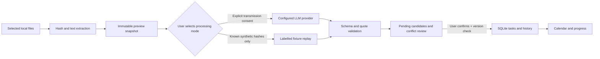

# Architecture

`app/documents.py` reads PDF pages, DOCX paragraphs/table rows, UTF-8 TXT and Markdown lines. `app/model.py` owns the single outbound request path and never executes document instructions or model tool calls. `app/engine.py` owns previews, content reuse, candidate validation and transactional decisions. Each course keeps only its newest temporary preview snapshot, enforced by a database uniqueness constraint and startup migration. Live consent includes the current scan ID, selected hashes and provider identity, and is checked again by the backend before transmission. A workflow lock prevents preview, provider-setting or course-deletion mutations during a multi-document live extraction. `app/store.py` owns persistent records and optimistic version checks. `server.py` exposes same-origin JSON endpoints and static resources. `dist/app.js` retains the existing planner; `dist/workflow.js` provides import, consent and review.

The service binds to 127.0.0.1. Host and Origin checks limit browser requests to its own local origin. It is a single-user application without a remote login service. Do not expose it on a public network or use a reverse proxy without a separate security design.

AI processing and task confirmation are separate transactions. A model failure cannot directly modify a confirmed task. An accepted decision is recoverable/idempotent via its proposal status. Every accepted task records source filename/hash and locators; updates record before/after history and preserve progress. Same-course stable identifiers are suggestions, not authority to overwrite a newer user edit.

API/settings routes never expose the saved key. Redirects of authenticated provider requests are rejected. Provider response bodies are not echoed in errors. Scan text and task history remain sensitive local data even when the key is excluded, so all runtime data is omitted from packaging.
